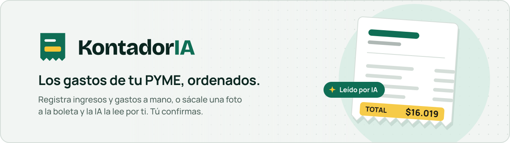
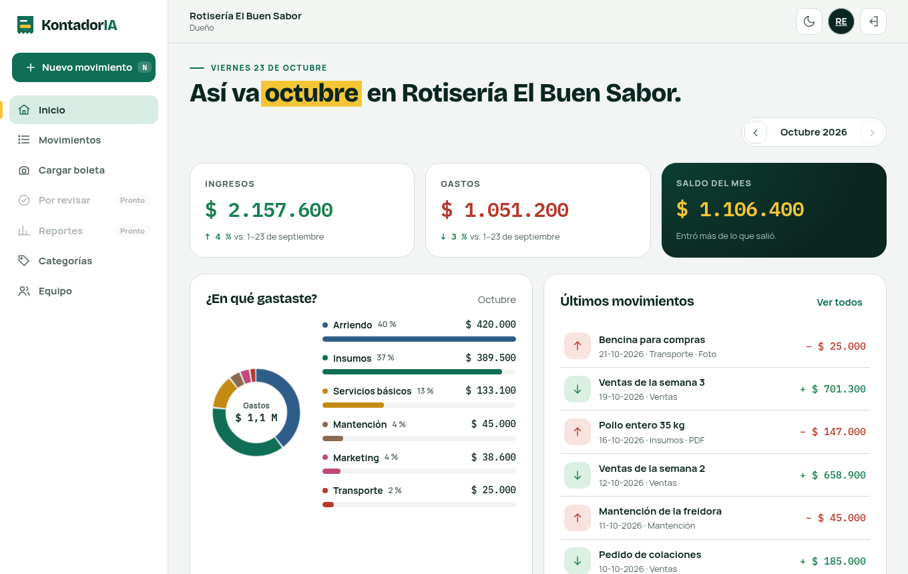
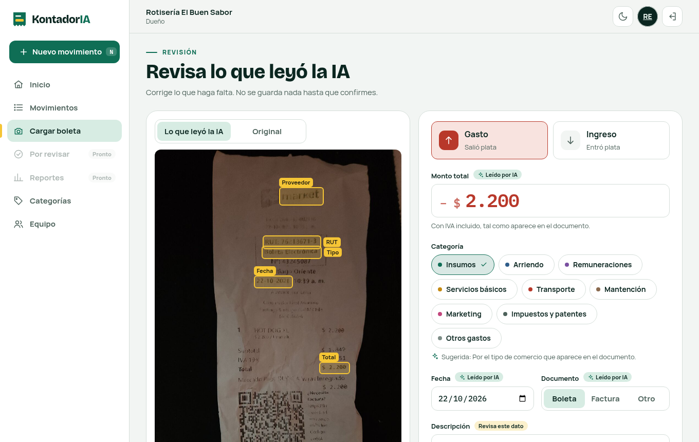
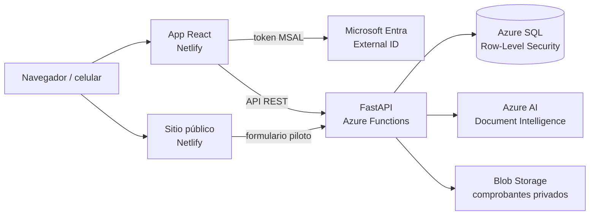

<div align="center">

<picture>
  <source media="(prefers-color-scheme: dark)" srcset=".github/assets/banner-oscuro.svg">
  
</picture>

<br><br>

[](https://github.com/Quezo149/Capstone/actions/workflows/test-backend.yml)


**[Abrir la app](https://app.kontadoria.cl)** · **[Sitio web](https://kontadoria.cl)** · [Cómo está hecho](#cómo-está-hecho) · [Correr en local](#correr-en-local) · [Equipo](#equipo)

</div>

<br>

<h3 align="center">Saca una foto a la boleta. KontadorIA hace el resto.</h3>

<p align="center">
La forma más simple de llevar los gastos e ingresos de tu PYME: sin planillas, sin papeles<br>
perdidos y sin aprender un software contable. Tu equipo registra, tu contador revisa y tú sabes<br>
en todo momento cómo va el mes.
</p>

<br>

<table>
<tr>
<td width="33%" valign="top">

### 📸 Boletas en segundos
Saca una foto o sube el PDF. La inteligencia artificial lee el comercio, el RUT, la fecha y el
total, te sugiere la categoría y te marca en la foto dónde encontró cada dato.

</td>
<td width="33%" valign="top">

### 👥 Todo tu equipo
Invita a tus empleados y a tu contador con un link. Cada uno ve y hace solo lo que su rol le
permite: el empleado registra lo suyo, el contador revisa todo, tú controlas.

</td>
<td width="33%" valign="top">

### 🔒 Tus datos, solo tuyos
Cada empresa vive aislada a nivel de base de datos. Nadie fuera de tu equipo ve tus números,
ni siquiera por error.

</td>
</tr>
</table>

<details>
<summary><b>About (English)</b></summary>
<br>

KontadorIA is the simplest way for small businesses to keep track of their income and expenses.
Snap a photo of a receipt and AI reads the merchant, date and total for you to confirm in one tap.
Invite your team and your accountant, each with their own role, and see how your month is going
at any time. Built on Azure, with each company's data isolated by Row-Level Security.

</details>

## Así se ve

<table>
<tr>
<td width="50%" valign="top">
<picture>
  <source media="(prefers-color-scheme: dark)" srcset=".github/assets/inicio-oscuro.png">
  
</picture>
<p align="center"><b>Tu mes, de un vistazo</b><br><sub>Ingresos, gastos, saldo y en qué se está yendo la plata</sub></p>
</td>
<td width="50%" valign="top">
<picture>
  <source media="(prefers-color-scheme: dark)" srcset=".github/assets/revision-oscuro.png">
  
</picture>
<p align="center"><b>La boleta se llena sola</b><br><sub>La IA marca dónde leyó cada dato; tú confirmas con un toque</sub></p>
</td>
</tr>
</table>

## Funciones

**Registro sin esfuerzo**
- Ingresos y gastos en segundos, desde el computador o el celular.
- Carga por foto o PDF con lectura automática de boletas y facturas. <sub>🚧 próximamente</sub>
- Categorías listas para usar y las tuyas propias, con su color.
- ¿Te equivocaste? Edita, anula o deshace al instante.

**Pensado para equipos**
- Tres roles: **administrador**, **contador** y **empleado**.
- Invitaciones por link, también por WhatsApp.
- Cada movimiento dice quién lo registró.

**Siempre sabes cómo vas**
- Ingresos, gastos y saldo del mes, comparados con el mes anterior.
- Gastos por categoría y búsqueda con filtros. <sub>🚧 resumen mensual próximamente</sub>
- Importación desde tus planillas CSV/XLSX. <sub>📅 en camino</sub>

> [!TIP]
> **La IA propone, tú decides.** Nada se guarda sin tu confirmación. Cada dato leído te dice si
> viene seguro o si conviene revisarlo, y por qué. Si subes la misma compra dos veces, KontadorIA
> te avisa.

## Cómo está hecho



| Capa | Tecnología |
|---|---|
| Frontend (`frontend/`, `landing/`) | React 19 + Vite, MSAL, publicado en Netlify |
| Backend (`backend/`) | Python 3.13, FastAPI sobre Azure Functions (Flex Consumption) |
| Base de datos (`db/`) | Azure SQL con Row-Level Security por empresa; migraciones SQL numeradas |
| Inteligencia artificial | Azure AI Document Intelligence, ajustado a boletas chilenas |
| Archivos | Azure Blob Storage, contenedor privado (solo el backend accede) |
| CI/CD | GitHub Actions: pruebas en cada PR y antes de cada deploy; login a Azure con OIDC, sin claves guardadas |

<details>
<summary><b>Estructura del repositorio</b></summary>
<br>

```
backend/            API (FastAPI + Azure Functions) y sus pruebas
  app/core/         autenticación, permisos por rol, RLS, RUT, lectura de boletas
  app/routers/      endpoints: auth, empresas, usuarios, invitaciones, categorías, movimientos
  tests/            pruebas automáticas (ver tests/README.md)
  scripts/          pruebas manuales contra Azure (lectura de boletas reales)
db/migrations/      migraciones SQL 0001…0009, en orden
frontend/           app web
landing/            sitio público
Prototipo/          prototipo navegable con datos de ejemplo
Fase1/, Fase 2/     documentos y evidencias del Capstone por fase
.github/workflows/  pruebas y deploy del backend
```

</details>

## Correr en local

Necesitas Docker, Python 3.13, Node 20+, el ODBC Driver 18 for SQL Server y Azure Functions Core Tools.

<details>
<summary><b>1. Base de datos y almacenamiento</b> (SQL Server y Azurite en Docker)</summary>
<br>

```bash
cp .env.example .env            # y pon una contraseña propia
docker compose up -d
```

</details>

<details>
<summary><b>2. Backend</b></summary>
<br>

```bash
cd backend
python -m venv .venv
.venv/bin/pip install -r requirements-dev.txt
cp local.settings.json.example local.settings.json   # completar con los valores locales
func start                                            # http://localhost:7071
```

Las migraciones se aplican con `db/run_migrations.py` (ver las instrucciones en el archivo).

</details>

<details>
<summary><b>3. App web</b></summary>
<br>

```bash
cd frontend
cp .env.example .env.local      # URL de la API e IDs de Entra
npm ci
npm run dev                     # http://localhost:5173
```

</details>

<details>
<summary><b>Prototipo</b> (no necesita backend)</summary>
<br>

```bash
cd Prototipo
python -m http.server 8000      # abrir http://localhost:8000
```

</details>

## Pruebas

```bash
docker compose up -d sqlserver
cd backend
.venv/bin/python -m pytest
```

Son **más de 190 pruebas**. Corren contra una base `kontadoria_test` que se crea desde cero con
todas las migraciones, y **nunca contra Azure**. Cubren, entre otras cosas:

- la validación de tokens (firma, emisor, audiencia, vencimiento);
- la matriz completa de permisos: cada rol intenta cada acción llamando directo a la API;
- el aislamiento entre empresas a nivel de base de datos;
- la lectura de boletas, con textos de boletas reales.

El detalle por historia de usuario está en [`backend/tests/README.md`](backend/tests/README.md).
En GitHub corren solas en cada pull request y antes de cada deploy.

## Seguridad

- **Aislamiento real entre empresas.** Row-Level Security en SQL Server impide ver o modificar
  datos de otra empresa, aunque el código tuviera un error.
- **Permisos en el servidor.** Cada llamada se verifica en el backend según el rol; ocultar un
  botón no es la protección.
- **Comprobantes privados.** Las fotos y PDFs se guardan en un contenedor sin acceso público.
- **Sin claves en el código.** El deploy se autentica con OIDC y la configuración vive en Azure.
- **Privacidad desde el diseño**, con consentimiento explícito y alineado con la Ley N° 21.719.

## Hoja de ruta

| | Entrega | Fechas |
|:---:|---|---|
| ✅ | Cuenta, empresa y aislamiento de datos | octubre |
| ✅ | Equipo, roles y registro de movimientos | octubre |
| 🚧 | Carga de boletas con IA y resumen mensual | 2–13 nov |
| 📅 | Importación desde planillas | 16–27 nov |

## Equipo

| Integrante | Rol |
|---|---|
| **Felipe Ignacio Quezada Rodríguez** | Desarrollo: frontend, backend, base de datos e infraestructura |
| **Vicente Ignacio Hermosilla Osses** | Documentación del proyecto |
| **Diego Andrés Gallardo Vázquez** | Pruebas y control de calidad |

<br>

<div align="center">
<picture>
  <source media="(prefers-color-scheme: dark)" srcset=".github/assets/logo-oscuro.svg">
  
</picture>
<br>
<sub>Proyecto Capstone · Duoc UC · 2026</sub>
</div>
